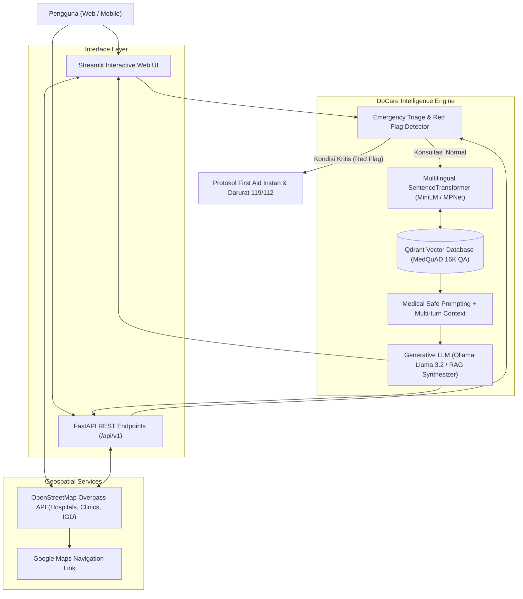

# 🩺 DoCare AI — Your Reliable Digital Health Companion

[](https://python.org)
[](https://fastapi.tiangolo.com)
[](https://streamlit.io)
[](https://qdrant.tech)
[-16A34A.svg)](https://github.com/abachaa/MedQuAD)
[](LICENSE)

> *"Your health, our priority, anytime, anywhere."*

**DoCare AI** adalah platform asisten kesehatan digital cerdas berbasis **Retrieval-Augmented Generation (RAG)**, **Emergency Medical Triage**, dan **Geospatial Healthcare Locator**. DoCare AI dirancang untuk membantu masyarakat mendapatkan informasi medis awal yang akurat, panduan pertolongan pertama (First Aid) instan saat kondisi kritis, serta rekomendasi instalasi gawat darurat (IGD) dan rumah sakit terdekat.

---

## 🌟 Fitur Utama

- 💬 **Konsultasi Gejala & Kesehatan (RAG Engine)**:
  - Menggunakan basis pengetahuan **16.345 pasangan tanya-jawab medis terverifikasi** dari dataset **MedQuAD** (NIH, GARD, GHR, NIDDK, NINDS).
  - Vektor semantik multilingual dengan pencarian kemiripan kosinus (*Cosine Similarity*) di **Qdrant Vector Database**.
  - Gaya respon empatik, profesional, serta dilengkapi referensi medis terverifikasi.

- 🚨 **Emergency Triage & Medical Guardrails**:
  - Deteksi otomatis gejala kritis (*Red Flags*), seperti:
    - **Hipoksia & Henti Napas**: Wajah/bibir membiru (*cyanosis*) disertai hilang kesadaran.
    - **Kedaruratan Kardiovaskular**: Nyeri dada hebat, sensasi tertekan (*chest pain / heart attack*).
    - **Gejala Stroke Akut**: Protokol FAST (*Face, Arms, Speech, Time*).
    - **Trauma & Pendarahan Hebat**: Penekanan langsung dan pencegahan syok.
  - Memotong alur tanya-jawab biasa untuk langsung menyajikan instruksi **First Aid** (P3K) dan nomor darurat resmi Indonesia (**119** / **112**).

- 🏥 **Pencari Fasilitas Medis Terdekat (Nearby Healthcare Locator)**:
  - Integrasi dengan **OpenStreetMap Overpass API** (bebas biaya, tanpa dependensi API key berbayar).
  - Menghitung jarak tempuh (*Haversine distance*) dan menyajikan tombol rute navigasi instan langsung ke **Google Maps**.

- 🔌 **Arsitektur Dual Interface**:
  - **Streamlit Interactive Web UI**: Dashboard interaktif yang ramah pengguna.
  - **FastAPI REST API**: Endpoint modular siap pakai untuk integrasi aplikasi mobile (Android/iOS) atau web frontend (Next.js/React).

---

## 🏗️ Arsitektur Sistem



---

## 📁 Struktur Direktori

```text
DoCareAi/
├── data/
│   └── cleaned_medquad.csv        # Dataset medis MedQuAD yang telah dibersihkan
├── docs/                          # Dokumentasi teknis & master plan
├── scripts/
│   └── ingest_data.py             # Script ETL & Ingestion data ke Qdrant
├── src/
│   ├── api/
│   │   └── main.py                # REST API FastAPI (/api/v1/chat, /triage, /hospitals)
│   ├── core/
│   │   └── config.py              # Konfigurasi aplikasi & environment settings
│   ├── rag/
│   │   ├── embeddings.py          # Mesin embedding vektor (SentenceTransformers)
│   │   ├── vector_store.py        # Manajer Qdrant Vector Database
│   │   └── engine.py              # DoCare RAG Orchestrator & LLM caller
│   ├── services/
│   │   └── hospital_service.py    # Pencarian RS/Klinik via OpenStreetMap
│   ├── triage/
│   │   └── emergency.py           # Evaluasi gejala darurat & panduan First Aid
│   └── ui/
│       └── app.py                 # Antarmuka web modern berbasis Streamlit
├── tests/
│   ├── test_hospital.py           # Unit test perhitungan jarak & fasilitas medis
│   ├── test_rag.py                # Unit test RAG engine & prompt builder
│   └── test_triage.py             # Unit test deteksi kedaruratan & protokol darurat
├── .env.example                   # Template konfigurasi environment
├── .gitignore                     # Filter git untuk file cache, venv, dan storage
├── requirements.txt               # Daftar dependensi Python
└── README.md                      # Dokumentasi utama proyek
```

---

## 🚀 Panduan Instalasi & Menjalankan Aplikasi

### 1. Prasyarat Sistem
- Python 3.10 atau lebih tinggi
- Git
- (Opsional) Ollama terpasang untuk LLM lokal (`ollama run llama3.2`)
- (Opsional) Docker untuk menjalankan Qdrant Server (`docker run -p 6333:6333 qdrant/qdrant`)

### 2. Kloning Repositori & Virtual Environment
```bash
git clone https://github.com/StevenHarun/DoCareAi.git
cd DoCareAi

# Buat virtual environment
python -m venv venv

# Aktifkan virtual environment
# Windows:
venv\Scripts\activate
# Linux/macOS:
source venv/bin/activate

# Install dependensi
pip install -r requirements.txt
```

### 3. Konfigurasi Lingkungan (`.env`)
Salin file template `.env.example` menjadi `.env`:
```bash
copy .env.example .env   # Windows
# cp .env.example .env    # Linux/Mac
```

### 4. Ingesti Data MedQuAD ke Qdrant
Jalankan skrip ingesti untuk mengindeks data ke Qdrant:
```bash
# Ingesti cepat 100 sampel (untuk pengujian instan):
python scripts/ingest_data.py --limit 100

# Atau ingesti seluruh 16.345 pasangan tanya-jawab:
python scripts/ingest_data.py
```
*Catatan: Sistem secara otomatis mendukung mode lokal on-disk (`./qdrant_storage`) tanpa harus menyalakan container Docker.*

### 5. Menjalankan Aplikasi

#### A. Antarmuka Web Streamlit
```bash
streamlit run src/ui/app.py
```
Akses di peramban web: `http://localhost:8501`

#### B. Backend REST API (FastAPI)
```bash
uvicorn src.api.main:app --reload --port 8000
```
Dokumentasi interaktif Swagger API dapat diakses di: `http://localhost:8000/docs`

---

## 🧪 Menjalankan Pengujian (Unit Tests)

Jalankan rangkaian unit test untuk memastikan seluruh komponen berfungsi:
```bash
python tests/test_triage.py
python tests/test_hospital.py
python tests/test_rag.py
```

---

## ⚖️ Disclaimer Medis & Hukum

> **PERINGATAN PENTING**:
> **DoCare AI** dirancang sebagai media edukasi informasi kesehatan awal dan triase kedaruratan. Aplikasi ini **BUKAN** pengganti nasihat medis, pemeriksaan klinis, atau diagnosis resmi dari dokter berlisensi.
> Apabila Anda atau orang di sekitar Anda mengalami kondisi yang mengancam nyawa (seperti henti napas, nyeri dada tembus ke punggung, pingsan, atau pendarahan masif), **SEGERA hubungi layanan darurat 119 / 112 atau datangi Instalasi Gawat Darurat (IGD) rumah sakit terdekat**.

---

## 👨‍💻 Kontributor & Pengembangan

Dikembangkan oleh **[Steven Harun Samba](https://github.com/StevenHarun)**.  
Proyek ini dikembangkan berawal dari proyek Capstone MSIB & inovasi *Digital Healthcare Assistant*.
